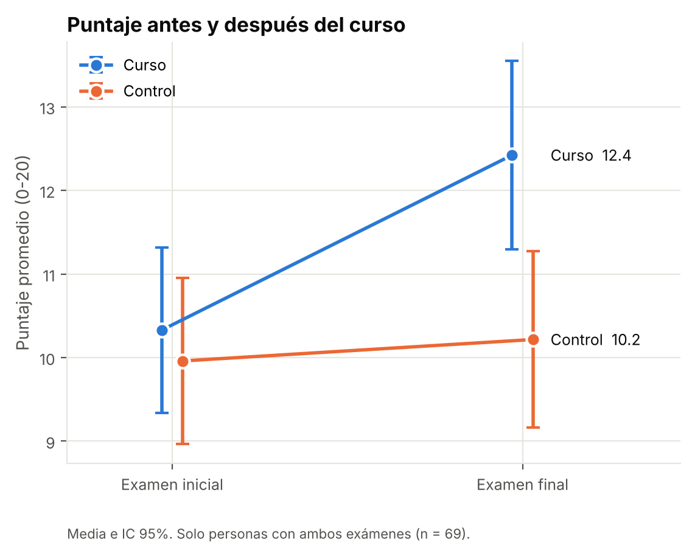
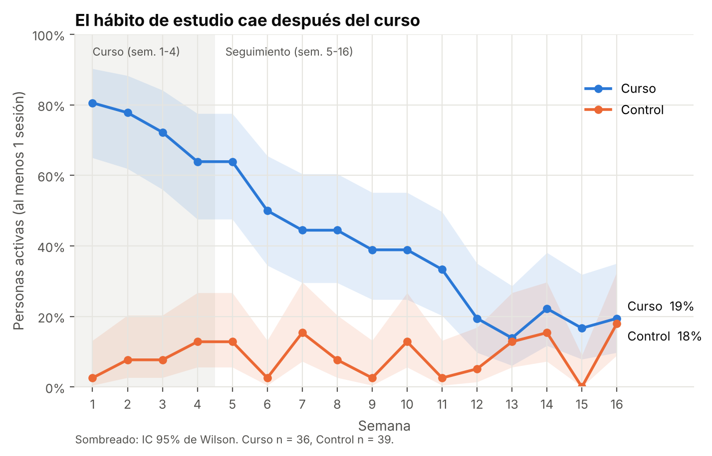

# ¿Funciona el curso de Excel?

Proyecto de People Analytics: evalúo con un experimento aleatorizado si un curso de Excel de una plataforma de aprendizaje mejora el desempeño de los colaboradores y si el hábito de estudio se mantiene después.

> El caso está inspirado en una necesidad real de mi trabajo: evaluar si los cursos de una plataforma de aprendizaje funcionan. Como no puedo usar datos de la empresa, simulé los datos con `datos/generar_datos.py`. Las cifras y los resultados son inventados y no reflejan a ninguna organización ni persona real.

## Resultado

El curso mejoró el examen práctico en **1.76 puntos de 20** frente al grupo control (IC 95%: 0.81 a 2.71). Es una mejora real, pero no alcanza los 2.5 puntos que fijé como criterio de éxito antes del análisis. Además, el hábito de estudio no se sostuvo: 12 semanas después del curso, el grupo que lo hizo estaba tan activo en la plataforma como el que no.

Mi recomendación es no escalar el curso como está, sino ajustarlo (sobre todo el seguimiento después del curso), combinarlo con microcápsulas de aprendizaje difundidas por los medios de comunicación de la empresa para sostener el hábito, y volver a medir.

## Diseño

75 colaboradores voluntarios se sortearon en dos grupos: 36 hicieron el curso (8 módulos en 4 semanas) y 39 quedaron en lista de espera como grupo control. Todos dieron un examen práctico antes y después, y se registró su uso semanal de la plataforma durante 16 semanas.

## Qué hice

- Revisé que el sorteo dejara grupos comparables. El nivel inicial quedó parejo, pero el control tenía más analistas, así que ajusté por cargo.
- Estimé el efecto con una regresión lineal que controla el puntaje inicial, el cargo y la antigüedad (ANCOVA), y lo comparé con una prueba t sobre la mejora. Las dos dan casi lo mismo.
- Revisé si las 6 personas sin examen final cambiaban la conclusión, con imputación múltiple y con un escenario pesimista. No la cambian.
- Para el hábito comparé el porcentaje de personas activas por semana y usé una curva de Kaplan-Meier para ver cuándo abandonan.
- Antes de analizar dejé por escrito el criterio de éxito y las definiciones (`PLAN_ANALISIS_PREVIO.md`).

## Archivos

- `analisis_curso_excel.ipynb`: el análisis completo, con resultados y gráficos.
- `utils_estadistica.py`: funciones estadísticas que usa el notebook.
- `datos/`: los datos, el script que los genera y el diccionario de datos.
- `figuras/`: los gráficos principales.
- `PLAN_ANALISIS_PREVIO.md`: las reglas que fijé antes del análisis.

Para correrlo: `pip install -r requirements.txt` y abrir el notebook.

## Limitaciones

- Los datos son simulados: el proyecto muestra el método, no un resultado real.
- Con 75 personas, los intervalos de confianza son amplios y no permiten comparar subgrupos con seguridad.
- Los participantes fueron voluntarios, así que los resultados no se pueden generalizar a toda la empresa.
- El examen no está validado formalmente y no se midió la aplicación de lo aprendido en el trabajo.
- El criterio de éxito (2.5 puntos) se definió antes del análisis formal, después de una revisión exploratoria de los promedios.

Como los datos son simulados, sé cuál es el efecto real que puse en el generador: alrededor de 1.77 puntos para este grupo. El análisis estimó 1.76, lo que me sirvió para comprobar que el método funciona.
